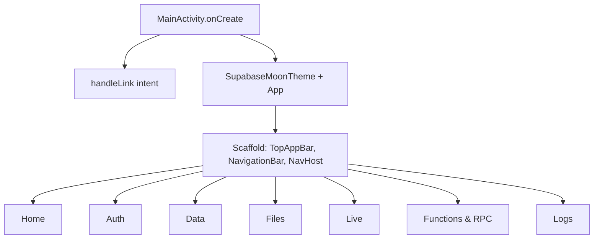
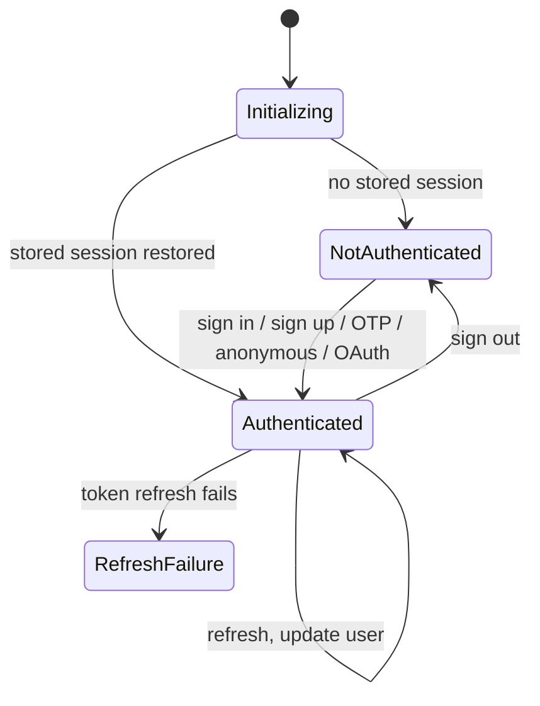
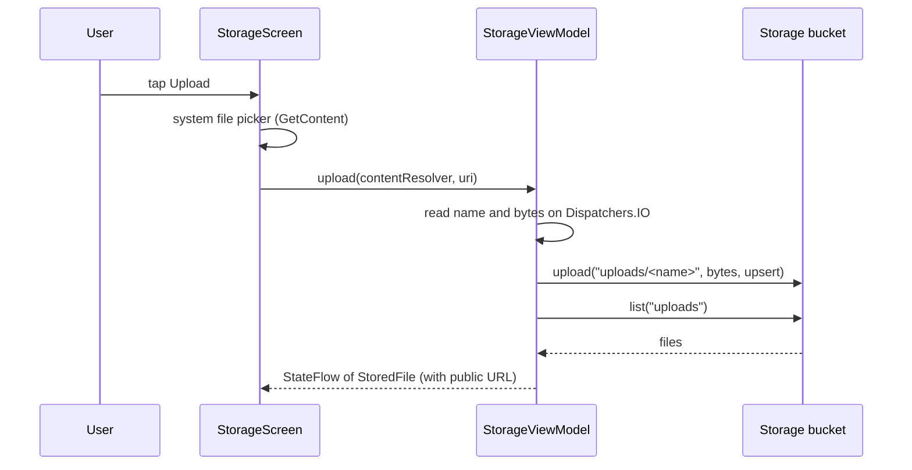

# Architecture and flow

## 1. Big picture

```mermaid
flowchart LR
    UI[Compose screens] -->|user events| VM[ViewModels]
    VM -->|suspend calls in viewModelScope| SB[SupabaseProvider.client]
    VM -->|logged&#123;&#125;| LOG[AppLog]
    SB --> AUTH[Auth /auth/v1]
    SB --> REST[Postgrest /rest/v1]
    SB --> STO[Storage /storage/v1]
    SB --> RT[Realtime websocket]
    SB --> FN[Functions /functions/v1]
    VM -->|StateFlow| UI
    LOG -->|StateFlow| LOGUI[Logs screen]
```

The app follows MVVM with unidirectional data flow:

- **Screens** (`ui/screens`) are stateless Composables. They collect `StateFlow`s with `collectAsStateWithLifecycle()` and send user actions to a ViewModel.
- **ViewModels** own the logic. Each Supabase call runs in `viewModelScope.launch`, on the main-safe suspend APIs of supabase-kt, and publishes results through `MutableStateFlow`.
- **`SupabaseProvider.client`** is one lazily created client shared by the whole app. It installs the Auth, Postgrest, Storage, Realtime and Functions plugins, configured from `BuildConfig.SUPABASE_URL` and `SUPABASE_KEY`.
- **`AppLog`** is a global in-memory log (newest first, capped at 300). Its `logged(tag, label) { … }` wrapper logs *start → success/failure*, rethrows `CancellationException`, and returns a `Result`.

## 2. Configuration

`app/build.gradle.kts` reads `supabase.url` and `supabase.key` from `local.properties` and writes them to `BuildConfig`. The key is the publishable key; what a user may do is decided by Postgres Row Level Security and the user's JWT, not by hiding the key.

## 3. App start and navigation

- Bottom tabs: Home, Auth, Data, Files, Live. Functions and Logs open from the top bar or Home cards.
- Deep link `supabasemoon://auth` is declared in `AndroidManifest.xml`. `MainActivity` passes the intent to `handleDeeplinks`, which finishes magic-link, password-reset and OAuth sign-ins and stores the session.

## 4. Session flow (Auth)

`AuthViewModel` exposes `auth.sessionStatus` directly. The Auth screen re-renders when it changes, and the Update-user section appears only when `Authenticated`. supabase-kt persists the session on the device and refreshes the JWT automatically.

Methods and the calls behind them:

| Action | Call |
|---|---|
| Sign up / in | `signUpWith(Email)`, `signInWith(Email)` |
| Magic link / OTP | `signInWith(OTP)`, then `verifyEmailOtp(...)` for the code |
| Anonymous | `signInAnonymously()` |
| OAuth | `signInWith(Github)` (opens browser, returns via deep link) |
| Reset password | `resetPasswordForEmail()` |
| Update user | `updateUser { password / data }` |
| Session tools | `refreshCurrentSession()`, `retrieveUserForCurrentSession()`, `signOut()` |

## 5. Database flow (PostgREST)

`DatabaseViewModel` talks to the `notes` table:

| UI action | Call |
|---|---|
| Load / search / filter | `from("notes").select { filter { ilike / eq }; order; limit }` |
| Add | `insert(Note(...)) { select() }` |
| Toggle done / rename | `update({ set(...) }) { filter { eq("id", id) } }` |
| Delete | `delete { filter { eq("id", id) } }` |

After each write the screen re-queries. `user_id` is not sent by the app: the column defaults to `auth.uid()`, and the RLS policies only let a user see or change their own rows. Without a session, writes fail with an RLS error, which is shown on screen and in the log.

## 6. Storage flow

Files live under `uploads/` in `test-bucket`. The bucket is public, so images preview from their public URL (Coil). *Signed URL* calls `createSignedUrl` (10 min), *Download* fetches the public file, and *Delete* removes it. Upload and delete need a signed-in user per the storage policies.

## 7. Realtime flow

`RealtimeViewModel` uses two independent channels.

**Postgres changes** (`db-notes`): `postgresChangeFlow<PostgresAction>(schema = "public") { table = "notes" }` emits Insert, Update, Delete events, which are prepended to a list and logged. This requires `notes` to be in the `supabase_realtime` publication, which `setup.sql` does.

**Room** (`room-lobby`): one channel for both features.
- Broadcast: `broadcastFlow<ChatMessage>("chat")` receives, `broadcast("chat", msg)` sends. `receiveOwnBroadcasts = true` lets one device see its own messages.
- Presence: `track(PresenceState(user))` announces the user. `presenceChangeFlow()` delivers joins and leaves, which update the online map.

Leaving a room calls `untrack`, `unsubscribe` and removes the channel. `onCleared()` also unsubscribes.

## 8. Functions and RPC

- **Edge Function:** `functions.invoke(function = name, body = JSON)` returns an HTTP response. The status and body text are displayed.
- **RPC:** `postgrest.rpc(name, JsonObject)` calls a Postgres function. The raw JSON result is displayed.

## 9. Diagnostics (Home)

*Run all checks* runs seven steps in order, each through `logged`, and updates its row green or red:

1. Auth service: `GET /auth/v1/health`
2. Auth session: current session if any
3. Database: `select` one row from `notes`
4. RPC: `add_numbers(2, 3)`
5. Storage: list `uploads/`
6. Realtime: connect the websocket
7. Edge Function: invoke `hello`

A failed step does not stop the rest, so one run shows which services are set up.

## 10. Logging

All screens report through `AppLog`. The Logs screen shows time, tag (Auth, Database, Storage, Realtime, Functions, Diagnostics), message and a coloured status dot. Use it to see exactly what was called and the server error text.

## 11. Security notes

- The app ships only the publishable key; access control is RLS and Storage policies in `setup.sql`.
- Do not add the secret key, `service_role` key or database password to the app or to git. `local.properties` and `cred.txt` are git-ignored.
- `setup.sql` makes `test-bucket` public-read for demo purposes. Make it private for real data.
